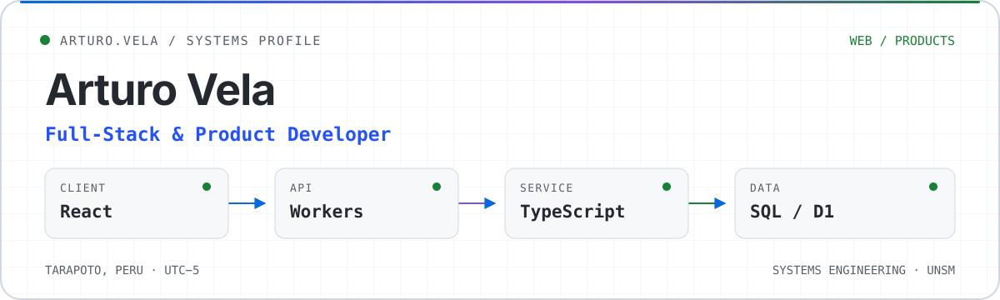

<picture>
  <source media="(prefers-color-scheme: dark)" srcset="./assets/hero-dark.svg">
  <source media="(prefers-color-scheme: light)" srcset="./assets/hero-light.svg">
  
</picture>

I build web products and internal systems, connecting interfaces, data and deployment around real workflows.

Based in **Tarapoto, Peru · UTC−5**. Systems Engineering student at **UNSM**. Open to full-stack roles, freelance projects and technical collaboration.

[Portfolio](https://velaarturo.com/en/) · [CV](https://cv.velaarturo.com/) · [Technical articles](https://blog.velaarturo.com/en/articles) · [Contact](mailto:dev@velaarturo.com)

## Selected work

### Nieto Import

Internal tools for **Nieto Import and Agromaf**: labels, documentation, corporate signatures and management forms. Full-stack development and product evolution, with permissions and web/mobile access.

**Next.js · React · TypeScript · Supabase · Capacitor**

[Public case study](https://velaarturo.com/en/projects/nieto-import)

### Second Brain

A private workspace for knowledge, tasks, projects and versioned files. Connects search and relationships with editorial publishing to my portfolio, blog and CV.

**React · TypeScript · Mantine · Cloudflare Workers · D1 · R2 · Queues**

[Public case study](https://velaarturo.com/en/projects/second-brain)

### Vela Ventas

Retail operations for Peruvian businesses: sales, purchases, stock by branch, daily cash closing, Kardex and audit trails. Business permissions and server-side data isolation.

**React · TypeScript · Chakra UI · Hono · Cloudflare Workers · D1**

[Product](https://ventas.velaarturo.com/)

### Explora San Martín

A tourism catalog with **164 sourced places**, a MapLibre map, server-rendered profiles and a personal passport. Product development combines traceable content with protected editorial workflows.

**React Router · React · TypeScript · Chakra UI · Workers · D1 · R2 · MapLibre**

[Try the app](https://explora.velaarturo.com/) · [Case study](https://velaarturo.com/en/projects/explora-san-martin)

## Stack in current projects

| Area | Tools |
| --- | --- |
| Interfaces | React, TypeScript, Next.js, React Router, Chakra UI, Mantine |
| APIs and data | Cloudflare Workers, Hono, SQL, D1, Supabase |
| Files and background work | R2, Queues, Worker Service Bindings |
| Verification | Vitest, Playwright, type checking, Git |

## Public code

- [Porta](https://github.com/ArturoVela/Porta) — portfolio built with React, Vite, Chakra UI and Cloudflare Workers; content supplied by Second Brain.
- [ApiRest](https://github.com/ArturoVela/ApiRest) — Java 17 and Spring Boot API for academic management.

## Tools and writing

[Browse my apps](https://velaarturo.com/en/dev#apps): document, image, text, color and coordination utilities. [Cotiza](https://cotiza.velaarturo.com/), [PDF](https://pdf.velaarturo.com/) and [Foto](https://foto.velaarturo.com/) are examples.

[Read how Cotiza was built](https://blog.velaarturo.com/en/articles/como-se-creo-cotiza): decimal calculations, recoverable drafts and document sharing.

**Have a product or process to improve?** [Let's talk](https://velaarturo.com/en/contact).
