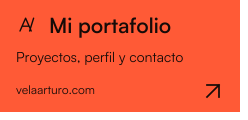
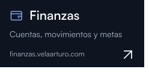
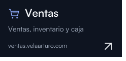
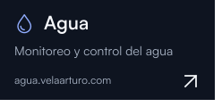
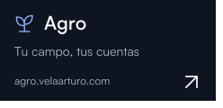
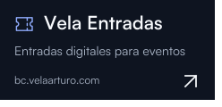
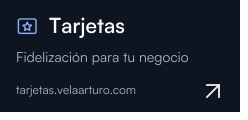

<a href="https://velaarturo.com/">
  <picture>
    <source media="(max-width: 600px) and (prefers-color-scheme: dark)" srcset="./assets/hero-mobile-dark.svg">
    <source media="(max-width: 600px)" srcset="./assets/hero-mobile-light.svg">
    <source media="(prefers-color-scheme: dark)" srcset="./assets/hero-dark.svg">
    
  </picture>
</a>

Construyo productos web y sistemas internos: conecto interfaces, datos y despliegue alrededor de procesos reales.

Desde **Tarapoto, Perú · UTC−5**. Estudiante de Ingeniería de Sistemas en la **UNSM**. Disponible para roles full-stack, proyectos freelance y colaboración técnica.

## Principal

  

[CV](https://cv.velaarturo.com/) · [Artículos técnicos](https://blog.velaarturo.com/es/articulos) · [Hablemos](https://velaarturo.com/es/contacto) · [Correo](mailto:dev@velaarturo.com)

## SaaS

Productos para organizar finanzas, negocios y operaciones. Algunas aplicaciones requieren iniciar sesión.

<!-- Los enlaces envuelven cada SVG: GitHub no permite interacción dentro de las imágenes. -->

  
  
  
  
  
  

## Proyectos destacados

### Nieto Import

Herramientas internas para **Nieto Import y Agromaf**: etiquetas, documentación, firmas corporativas y formularios de gestión. Desarrollo full-stack y evolución del producto, con permisos y acceso web y móvil.

**Next.js · React · TypeScript · Supabase · Capacitor**

[Ver caso de estudio](https://velaarturo.com/es/proyectos/nieto-import)

### Second Brain

Espacio privado para conocimiento, tareas, proyectos y archivos versionados. Conecta búsqueda y relaciones con la publicación editorial en mi portafolio, blog y CV.

**React · TypeScript · Mantine · Cloudflare Workers · D1 · R2 · Queues**

[Ver caso de estudio](https://velaarturo.com/es/proyectos/second-brain)

### Vela Ventas

Operaciones comerciales para negocios peruanos: ventas, compras, stock por sucursal, cierre diario de caja, Kardex y trazabilidad. Permisos por negocio y aislamiento de datos en el servidor.

**React · TypeScript · Chakra UI · Hono · Cloudflare Workers · D1**

[Abrir Vela Ventas](https://ventas.velaarturo.com/)

### Explora San Martín

Catálogo turístico con **164 lugares documentados**, mapa MapLibre, fichas renderizadas en el servidor y pasaporte personal. Combina contenido trazable con flujos editoriales protegidos.

**React Router · React · TypeScript · Chakra UI · Workers · D1 · R2 · MapLibre**

[Explorar la app](https://explora.velaarturo.com/) · [Ver caso de estudio](https://velaarturo.com/es/proyectos/explora-san-martin)

## Stack actual

- **Interfaces:** React, TypeScript, Next.js, React Router, Chakra UI y Mantine.
- **APIs y datos:** Cloudflare Workers, Hono, SQL, D1 y Supabase.
- **Archivos y tareas en segundo plano:** R2, Queues y Worker Service Bindings.
- **Verificación:** Vitest, Playwright, comprobación de tipos y Git.

## Código público

- [Porta](https://github.com/ArturoVela/Porta) — portafolio con React, Vite, Chakra UI y Cloudflare Workers; contenido desde Second Brain.
- [ApiRest](https://github.com/ArturoVela/ApiRest) — API de gestión académica con Java 17 y Spring Boot.

## Herramientas y artículos

[Explora mis apps](https://velaarturo.com/dev#apps): utilidades de documentos, imágenes, texto, color y coordinación. Algunas son [Cotiza](https://cotiza.velaarturo.com/), [PDF](https://pdf.velaarturo.com/) y [Foto](https://foto.velaarturo.com/).

[Cómo se creó Cotiza](https://blog.velaarturo.com/es/articulos/como-se-creo-cotiza): cálculos decimales, borradores recuperables y documentos compartidos.

**¿Tienes un producto o proceso por mejorar?** [Hablemos](https://velaarturo.com/es/contacto).
