

<a href="https://velaarturo.com/">
  <picture>
    <source media="(max-width: 600px) and (prefers-color-scheme: dark)" srcset="./assets/hero-mobile-dark.svg">
    <source media="(max-width: 600px)" srcset="./assets/hero-mobile-light.svg">
    <source media="(prefers-color-scheme: dark)" srcset="./assets/hero-dark.svg">
    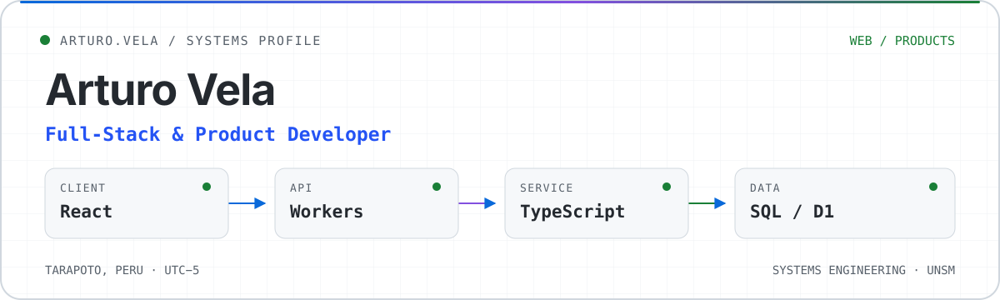
  </picture>
</a>

Construyo **productos web y sistemas para operaciones reales**: desde entradas con trazabilidad blockchain hasta catálogos comerciales, herramientas internas y aplicaciones de uso diario.

Desde **Tarapoto, Perú · UTC−5**. Estudiante de Ingeniería de Sistemas en la **UNSM**. Disponible para roles full-stack, proyectos freelance y colaboración técnica.

[Portafolio](https://velaarturo.com/) · [CV](https://cv.velaarturo.com/) · [Artículos](https://blog.velaarturo.com/es/articulos) · [Contacto](mailto:dev@velaarturo.com)

[Productos destacados](#productos-destacados) · [Más productos](#más-productos) · [Stack](#stack-actual) · [Actividad](#actividad-en-github)

## Productos destacados

### 01 / Vela Entradas · Blockchain aplicada

<a href="https://bc.velaarturo.com/blockchain">
  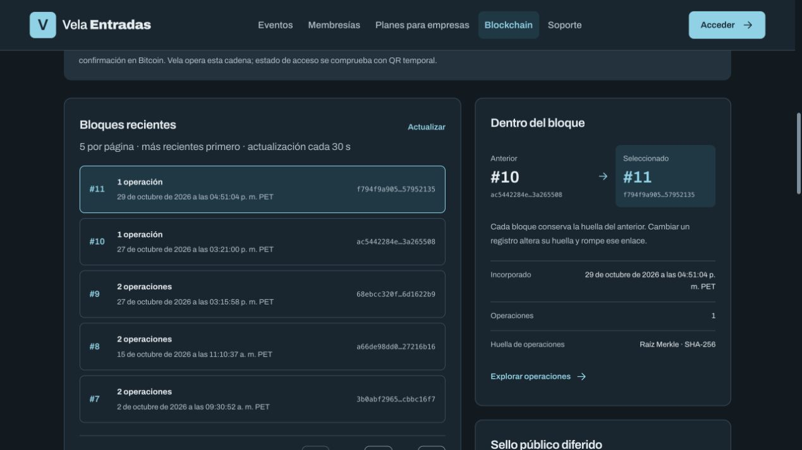
</a>

Plataforma de entradas para asistentes y organizadores. Combina **QR temporales, canje único y transferencias** con un registro verificable de emisión, uso y revocación.

La blockchain privada enlaza bloques SHA-256 y pruebas Merkle. **OpenTimestamps permite verificar su existencia en Bitcoin** cuando el sello externo se confirma. Vela opera la cadena; no utiliza consenso descentralizado.

`React` `TypeScript` `Cloudflare Workers` `D1` `R2` `SHA-256` `OpenTimestamps`

[Abrir producto](https://bc.velaarturo.com/) · [Explorar blockchain](https://bc.velaarturo.com/blockchain) · [Ver proyecto](https://velaarturo.com/es/proyectos/bc)

### 02 / Agromaf · Catálogo y cotización

<a href="https://web.agromaf.pe/">
  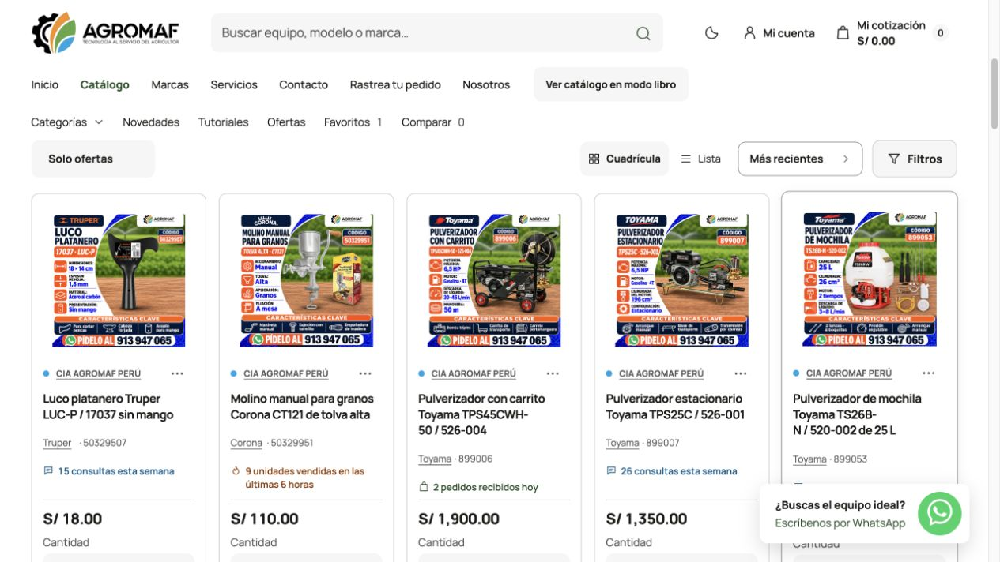
</a>

Web comercial para **Cia Agromaf y Cia Agromaf Perú**. Catálogo por empresa, marcas, fichas técnicas, comparación de productos y carrito de cotización que prepara la consulta por WhatsApp.

Administración de productos y contenido, permisos por empresa, fotografías en R2 y catálogos PDF. Una misma plataforma conecta la consulta pública con el trabajo del equipo.

`Astro` `TypeScript` `Supabase` `Cloudflare Workers` `R2`

[Visitar Agromaf](https://web.agromaf.pe/) · [Explorar catálogo](https://web.agromaf.pe/catalogo)

### 03 / Nieto Import · Operaciones y datos

<a href="https://nieto.velaarturo.com/">
  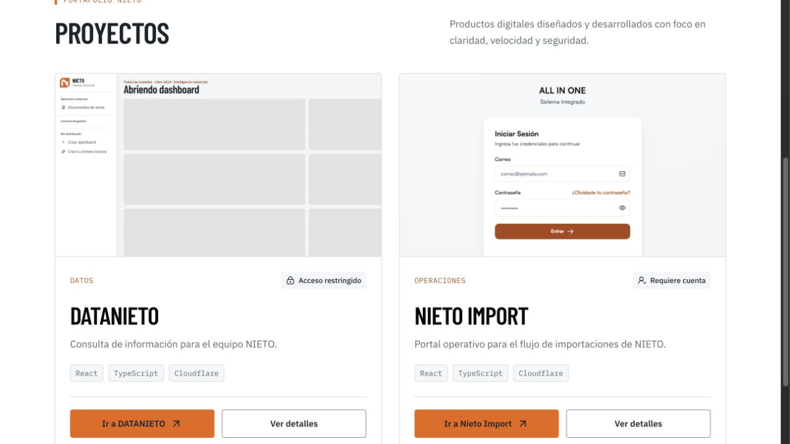
</a>

Herramientas internas para **Nieto Import y Agromaf**: etiquetas, documentación, firmas corporativas y formularios de gestión, con permisos y acceso web y móvil.

El ecosistema incluye **DATANIETO**, que convierte información comercial histórica en paneles consultables, y **NIETO Hub**, su escaparate público. Los sistemas operativos requieren autorización.

`Next.js` `React` `TypeScript` `Supabase` `Capacitor` `Cloudflare`

[Ver NIETO Hub](https://nieto.velaarturo.com/) · [Caso Nieto Import](https://velaarturo.com/es/proyectos/nieto-import) · [Caso DATANIETO](https://velaarturo.com/es/proyectos/db-nieto)

## Más productos

<strong>Second Brain</strong> · Conocimiento y publicación

Espacio privado para conocimiento, tareas, relaciones y archivos versionados. Publica contenido hacia mi portafolio, blog y CV.

`React` `TypeScript` `Mantine` `Workers` `D1` `R2` `Queues`

[Ver caso de estudio](https://velaarturo.com/es/proyectos/second-brain) · Acceso privado

<strong>Vela Ventas</strong> · Operación comercial

Ventas, compras, inventario por sucursal, caja diaria y Kardex para comercios peruanos. Permisos por negocio y aislamiento de datos en el servidor.

`React` `TypeScript` `Chakra UI` `Hono` `Workers` `D1`

[Abrir producto](https://ventas.velaarturo.com/)

<strong>Explora San Martín</strong> · Turismo con fuentes verificables

Mapa turístico, **164 lugares documentados** con fuentes y pasaporte personal. Combina fichas renderizadas en el servidor con flujos editoriales protegidos.

`React Router` `React` `TypeScript` `MapLibre` `Workers` `D1` `R2`

[Explorar la app](https://explora.velaarturo.com/) · [Ver caso de estudio](https://velaarturo.com/es/proyectos/explora-san-martin)

<strong>Cafetero</strong> · Directorio y pasaporte de cafeterías

Cafeterías del Perú con mapas, fichas verificables y registro de visitas.

`React Router` `React` `TypeScript` `Chakra UI`

[Ver caso de estudio](https://velaarturo.com/es/proyectos/coffee)

<strong>Cotiza</strong> · Cotizaciones y documentos

Cotizaciones y borradores de contratos con cálculos decimales, borradores recuperables y exportación PDF.

[Abrir herramienta](https://cotiza.velaarturo.com/) · [Cómo lo construí](https://blog.velaarturo.com/es/articulos/como-se-creo-cotiza)

<strong>Más SaaS y herramientas de mi ecosistema</strong>

Productos para finanzas, operaciones y fidelización. Algunas aplicaciones requieren cuenta o autorización.

<!-- Los enlaces envuelven cada SVG: GitHub no permite interacción dentro de las imágenes. -->

  <a href="https://finanzas.velaarturo.com/">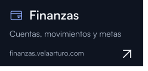</a>
  <a href="https://ventas.velaarturo.com/">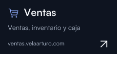</a>
  <a href="https://agua.velaarturo.com/">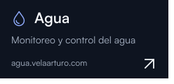</a>
  <a href="https://agro.velaarturo.com/">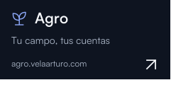</a>
  <a href="https://bc.velaarturo.com/">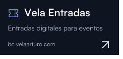</a>
  <a href="https://tarjetas.velaarturo.com/">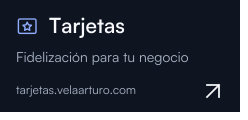</a>

También construyo herramientas que procesan archivos en el navegador: [PDF](https://pdf.velaarturo.com/) y [Foto](https://foto.velaarturo.com/). Encuentra el resto en [mi catálogo de proyectos](https://velaarturo.com/es/proyectos).

## Stack actual

- **Interfaces:** React, TypeScript, Astro, Next.js, React Router, Chakra UI y Mantine.
- **APIs y datos:** Cloudflare Workers, Hono, SQL, D1 y Supabase.
- **Archivos y tareas en segundo plano:** R2, Queues y Worker Service Bindings.
- **Verificación:** Vitest, Playwright, comprobación de tipos y Git.

  
  
  
  
  

## Actividad en GitHub

Commits, pull requests, estrellas, lenguajes y rachas. Las tarjetas se generan diariamente en este repositorio; cada componente utiliza el período que indica.

  <a href="https://github.com/ArturoVela?tab=repositories">
    <picture>
      <source media="(prefers-color-scheme: dark)" srcset="./assets/github-stats-dark.svg">
      
    </picture>
  </a>
  <a href="https://github.com/ArturoVela?tab=repositories">
    <picture>
      <source media="(prefers-color-scheme: dark)" srcset="./assets/github-languages-dark.svg">
      
    </picture>
  </a>

<a href="https://github.com/ArturoVela?tab=overview">
  <picture>
    <source media="(prefers-color-scheme: dark)" srcset="./assets/github-streak-dark.svg">
    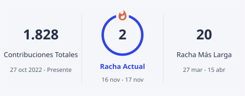
  </picture>
</a>

<strong>Mi calendario de contribuciones, en modo Snake</strong>

Una serpiente recorre el calendario de contribuciones del último año.

<picture>
  <source media="(prefers-color-scheme: dark)" srcset="./assets/github-snake-dark.svg">
  
</picture>

Las estadísticas de código reflejan repositorios públicos; las rachas siguen mi calendario visible de GitHub. Los lenguajes no miden dominio técnico. Componentes: <a href="https://github.com/stats-organization/github-readme-stats-action">Readme Stats Action</a>, <a href="https://github.com/DenverCoder1/github-readme-streak-stats">Streak Stats</a> y <a href="https://github.com/Platane/snk">Snake</a>. <a href="https://github.com/ArturoVela/ArturoVela/actions/workflows/profile-cards.yml">Ver actualización</a>.

## Código público

- [Porta](https://github.com/ArturoVela/Porta) — portafolio con React, Vite, Chakra UI y Cloudflare Workers; contenido desde Second Brain.
- [ApiRest](https://github.com/ArturoVela/ApiRest) — API de gestión académica con Java 17 y Spring Boot.

**¿Tienes un producto o proceso por mejorar?** [Hablemos](https://velaarturo.com/es/contacto).
